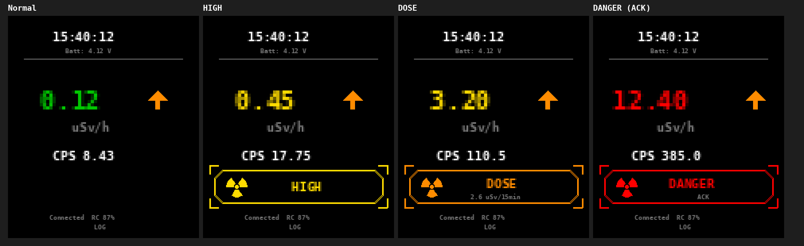

# RadZilla

**External display for RadiaCode radiation detectors** – a small MicroPython
firmware for the Waveshare ESP32-S3-LCD-1.69 that connects to a RadiaCode 10x
via Bluetooth and shows dose rate, count rate, trend and alarms on a 1.69"
screen, with a CSV log of all readings.

> ⚠️ **Experimental hobby project – not a safety device.**
> Readings and alarms may be delayed, wrong or missing. Do not rely on
> RadZilla for radiation protection. Provided without any warranty or
> liability – see [NOTICE.md](NOTICE.md).

RadZilla is an independent project and is not affiliated with the
manufacturer of RadiaCode devices.



*Simulated preview – on the device the built-in 8×8 pixel font is used.*

---

## Features

- **Live display** of dose rate (µSv/h) and count rate (CPS), large value
  switchable with the PWR button
- **Colour levels** green / yellow / red with configurable thresholds
- **Trend arrow** ↑ → ↓ (last 10 s vs. the 10 s before)
- **Three alarms** with hysteresis, blinking HUD frame with radiation symbol,
  configurable beep patterns, repeat limits and acknowledge:
  - *HIGH* (yellow) from 0.28 µSv/h – something radioactive is nearby
  - *DANGER* (red) from 10 µSv/h – immediate alarm
  - *DOSE* (orange) – more than 2.5 µSv collected within 15 min, i.e. a
    longer stay near a source; triggers the faster the higher the dose rate
- **CSV log** every 3 s in `/logs`, automatic clean-up after 24 h and
  overflow protection
- **Clock** synced with the PTB atomic clock via NTP (CET/CEST, automatic
  daylight saving time), list of known WiFi networks
- **Status bar** with time and board battery, RadiaCode battery level
- **Battery operation** with soft power switch (long press = off)
- Automatic **reconnect** after Bluetooth loss

## Hardware

| Part | Notes |
|---|---|
| Waveshare **ESP32-S3-LCD-1.69**, hardware **V2**, without touch | ESP32-S3R8, 8 MB octal PSRAM, 16 MB flash, 240×280 IPS |
| **RadiaCode 10x** (tested: RC-102) | connected via Bluetooth LE |
| optional: 1-cell LiPo 3.7 V with protection circuit, MX1.25 2-pin plug | ⚠ check polarity before connecting |

Details, pin-out and power: [docs/HARDWARE.md](docs/HARDWARE.md)

## Quick start

1. Flash **MicroPython ≥ 1.29, variant ESP32_GENERIC_S3 SPIRAM_OCT** (official
   build from micropython.org).
2. Install **aioble** on the board (`mip.install("aioble")`).
3. Copy `board/secrets_example.py` to `board/secrets.py` and enter your WiFi.
4. Upload **all files from `board/`** to the root of the board (Thonny).
5. Disconnect the RadiaCode phone app, press **RST**.

Step-by-step guide and troubleshooting: [docs/SETUP.md](docs/SETUP.md)

## Operation

| PWR button | Action |
|---|---|
| short press | alarm active → acknowledge all alarms · otherwise swap µSv/h ↔ CPS |
| double press | time sync with the PTB atomic clock |
| long press (2 s) | beep and switch off (battery only) |

Screen layout (top to bottom): clock · board battery · large value with trend
arrow · unit · second value · alarm frame · connection status and RadiaCode
battery · log status.

Log files: `/logs/rc_YYYY-MM-DD_HHMM.csv` with `Time;uSv/h;CPS;Alarm;Dose15`
(alarm 0 = none, 1 = HIGH, 2 = DANGER, 3 = DOSE; Dose15 = µSv within the dose
window), semicolon and decimal comma.

If several alarms are active, the frame shows DANGER > DOSE > HIGH; one short
PWR press acknowledges all of them.

## Configuration

| File | Content | In git |
|---|---|---|
| `board/config.py` | base system (display, button, clock, NTP) | yes |
| `board/rc_config.py` | RadiaCode, alarms, trend, log | yes |
| `board/secrets.py` | your WiFi credentials | **no** (`.gitignore`) |
| `board/secrets_example.py` | template with placeholders | yes |

All settings explained: [docs/CONFIGURATION.md](docs/CONFIGURATION.md)

## Repository layout

```
radzilla/
├── board/            files for the board (upload all of them)
│   ├── boot.py           power latch + buzzer off, runs first
│   ├── main.py           base system, tasks, status bar
│   ├── app.py            RadiaCode display, alarms, dose alarm, trend, log
│   ├── config.py         base settings
│   ├── rc_config.py      application settings
│   ├── secrets_example.py
│   ├── radiacode.py      Bluetooth protocol
│   ├── logger.py         CSV log
│   ├── ntp.py            NTP + CET/CEST
│   ├── st7789.py         display driver
│   ├── pcf85063.py       RTC driver
│   ├── battery.py        battery voltage
│   ├── power.py          power latch, PWR button, buzzer
│   └── pins.py           pin assignment (V2)
├── docs/             HARDWARE, SETUP, CONFIGURATION
├── tools/            computer-side helpers (planned: log evaluation)
├── LICENSE.md        CC BY-NC 4.0
├── NOTICE.md         disclaimer, trademarks, acknowledgements
└── CHANGELOG.md
```

## Acknowledgements

The RadiaCode Bluetooth protocol follows the excellent Python library
[cdump/radiacode](https://github.com/cdump/radiacode) (MIT). Thanks also to
MicroPython, aioble and Waveshare. Details in [NOTICE.md](NOTICE.md).

## License

**RadZilla © 2026 Shimizilla** – licensed under
[CC BY-NC 4.0](https://creativecommons.org/licenses/by-nc/4.0/):
free to use, share and adapt for **non-commercial** purposes with
**attribution**. See [LICENSE.md](LICENSE.md).
